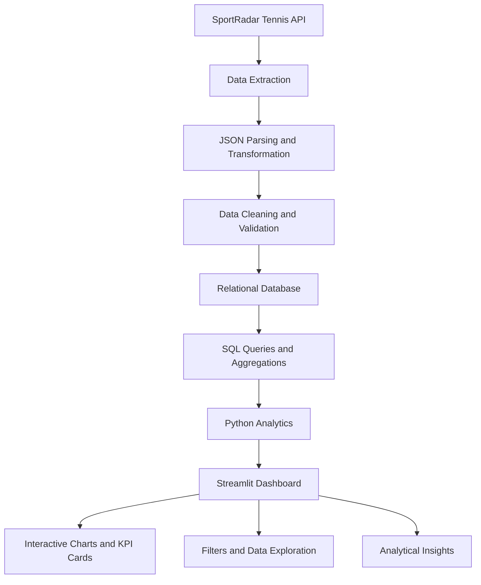

# 🎾 Game Analytics: Unlocking Tennis Data with SportRadar API

> **Turning tennis data into actionable sports intelligence through API integration, Python, SQL, and interactive data visualization.**

[](https://game-analytics-unlocking-tennis-data-with-sportradar-api-bbzyn.streamlit.app/)
[](https://www.python.org/)
[](https://www.mysql.com/)
[](https://plotly.com/)

## 🚀 Live Demo

**Explore the interactive application:**  
https://game-analytics-unlocking-tennis-data-with-sportradar-api-bbzyn.streamlit.app/

This project demonstrates an end-to-end sports analytics workflow that collects tennis data from the SportRadar API, transforms structured and nested JSON responses into relational data, performs SQL-based analysis, and presents insights through a Streamlit dashboard.

---

## 📌 Table of Contents

1. [Project Overview](#-project-overview)
2. [Business Problem](#-business-problem)
3. [Project Objectives](#-project-objectives)
4. [Technology Stack](#-technology-stack)
5. [Project Architecture](#-project-architecture)
6. [Dashboard Features](#-dashboard-features)
7. [Key Performance Indicators](#-key-performance-indicators)
8. [SQL Analytics](#-sql-analytics)
9. [Data Engineering Workflow](#-data-engineering-workflow)
10. [Project Structure](#-project-structure)
11. [Installation and Setup](#-installation-and-setup)
12. [GitHub Upload Guide](#-github-upload-guide)
13. [Deployment](#-deployment)
14. [Data Quality and Security](#-data-quality-and-security)
15. [Business Value](#-business-value)
16. [Future Enhancements](#-future-enhancements)
17. [Skills Demonstrated](#-skills-demonstrated)
18. [Author](#-author)

---

## 🎯 Project Overview

**Game Analytics: Unlocking Tennis Data with SportRadar API** is a sports data analytics project focused on transforming tennis data into structured, interactive and business-oriented insights.

The project combines data extraction, data processing, relational database management, SQL analytics and dashboard development into one end-to-end solution.

### Core capabilities

- Integrate with the SportRadar Tennis API.
- Extract competition and competitor-ranking data.
- Transform API responses into structured datasets.
- Organize tennis entities using relational database concepts.
- Analyze tournament categories, player rankings and country-level distributions.
- Present analytical results through interactive visualizations.
- Enable users to explore and filter available tennis data.

**Live application:** [Open the Tennis Analytics Dashboard](https://game-analytics-unlocking-tennis-data-with-sportradar-api-bbzyn.streamlit.app/)

## 💼 Business Problem

Sports organizations and analysts work with large volumes of structured and semi-structured data covering tournaments, competitors, rankings, venues and competition categories.

Raw API responses are not always convenient for direct analysis. Nested JSON, repeated entities, inconsistent field availability and relationships between records can make reporting difficult.

This project addresses these challenges by building a workflow that converts tennis data into a more accessible analytical format.

### Business questions

- How are tennis competitions distributed across categories and formats?
- Which countries are represented in the available competitor-ranking data?
- Which competitors occupy the highest ranking positions?
- How are ranking points distributed among players?
- Which competitors have maintained, improved or declined in ranking?
- How can users explore competition and ranking information efficiently?
- How can SQL and interactive visualizations support data-driven decisions?

## 🎯 Project Objectives

1. **Data extraction:** Retrieve available tennis information through API integration.
2. **Data transformation:** Parse, clean and normalize the collected information.
3. **Database management:** Structure tennis entities using relational tables and keys.
4. **SQL analytics:** Answer analytical questions using reusable queries.
5. **Interactive visualization:** Build a dashboard for data exploration and reporting.
6. **Data quality:** Validate records, missing values, duplicates and relationships.
7. **Business intelligence:** Translate analytical results into understandable insights.

## 🛠️ Technology Stack

| Technology | Purpose |
|---|---|
| Python | API integration, data processing and application logic |
| SportRadar Tennis API | Tennis data source |
| Pandas | Data transformation and analysis |
| SQL | Data retrieval, aggregation and analytical queries |
| MySQL / relational SQL | Structured data storage, depending on the configured database |
| Streamlit | Interactive web application |
| Plotly / supported charting libraries | Interactive data visualization |
| Jupyter Notebook | Exploration, experimentation and analysis |
| Git and GitHub | Version control and project documentation |

*The exact database engine and visualization libraries should match the dependencies and implementation in the published project.*

## 🏗️ Project Architecture

The project follows an API-to-analytics workflow.



### Architecture explanation

**1. Data source**

Retrieve the tennis information available to the configured SportRadar API account.

**2. Extraction and transformation**

Process API responses and convert nested objects into structured records.

**3. Relational storage**

Organize entities into related tables, using appropriate primary and foreign keys where supported.

**4. SQL analytics**

Use queries to retrieve rankings, summarize competitions and analyze geographical distributions.

**5. Dashboard presentation**

Display results using interactive filters, metric cards, charts and data tables.

**6. Business interpretation**

Use the resulting summaries to explore tennis competition structures and competitor-ranking patterns.

## 📊 Dashboard Features

The following feature descriptions provide a professional overview of the analytical capabilities to document. Keep only those that are actually implemented in the live application.

### 1. Executive Overview

A high-level summary of the available tennis data.

Potential KPIs:
- Total competitors
- Total competitions
- Countries represented
- Highest ranking-points value

### 2. Competition Analytics

Explore competition structures and tournament categories.

Suggested visualizations:
- Competition counts by category
- Competition format distribution
- Gender distribution, when provided
- Parent and child competition relationships

### 3. Competitor Rankings

Analyze player rankings and available ranking points.

Suggested visualizations:
- Top-ranked competitors
- Ranking-points distribution
- Competitor search
- Ranking movement analysis
- Competitions played by player

### 4. Country-Level Analytics

Explore the geographical distribution of available competitor data.

Suggested visualizations:
- Competitors by country
- Aggregate ranking points by country
- Average ranking points by country
- Country-level comparison tables

Country comparisons should account for differences in the number of represented competitors.

### 5. Interactive Data Exploration

Enable users to examine records through appropriate controls.

- Search by competitor name
- Filter by country
- Select ranking ranges
- Filter by competition category
- Sort and inspect analytical tables
- Export filtered results, if supported

### 6. SQL Analytics

Provide a transparent connection between the database layer and the insights shown in the dashboard.

Examples include top-ranked competitors, ranking movement, country-level aggregates and competition distributions.

## 📈 Key Performance Indicators

These are recommended KPI definitions; use the fields and metrics available in the actual dataset.

| KPI | Suggested calculation | Purpose |
|---|---|---|
| Total competitors | Count of unique competitor IDs | Measure player coverage |
| Total competitions | Count of unique competition IDs | Measure competition coverage |
| Countries represented | Count of distinct country values | Measure geographical coverage |
| Highest ranking-points value | Maximum ranking points | Identify the largest observed points value |
| Stable rankings | Count of records with zero movement | Examine ranking stability |
| Average points per competitor | Total valid points divided by valid competitor count | Summarize ranking-point distribution |

**Interpretation note:** Ranking position and ranking points are different measures. A larger points total does not necessarily mean a larger numerical rank value; ranking position 1 generally represents a better position than ranking position 10.

## 🧮 SQL Analytics

The project can answer common sports analytics questions using relational SQL.

The following examples assume tables and columns named `Competitors` and `Competitor_Rankings`. Adjust identifiers to match the actual database schema.

### Query 1 — Top 10 competitors by ranking position

```sql
SELECT
    c.name AS competitor_name,
    c.country,
    r.rank,
    r.points
FROM Competitors AS c
JOIN Competitor_Rankings AS r
    ON c.competitor_id = r.competitor_id
WHERE r.rank IS NOT NULL
ORDER BY r.rank ASC
LIMIT 10;
```

### Query 2 — Competitor count by country

```sql
SELECT
    country,
    COUNT(DISTINCT competitor_id) AS competitor_count
FROM Competitors
WHERE country IS NOT NULL
GROUP BY country
ORDER BY competitor_count DESC;
```

### Query 3 — Competitors with stable rankings

```sql
SELECT
    c.name AS competitor_name,
    r.rank,
    r.movement,
    r.points
FROM Competitors AS c
JOIN Competitor_Rankings AS r
    ON c.competitor_id = r.competitor_id
WHERE r.movement = 0
ORDER BY r.rank ASC;
```

### Query 4 — Total ranking points by country

```sql
SELECT
    c.country,
    SUM(r.points) AS total_ranking_points
FROM Competitors AS c
JOIN Competitor_Rankings AS r
    ON c.competitor_id = r.competitor_id
WHERE c.country IS NOT NULL
GROUP BY c.country
ORDER BY total_ranking_points DESC;
```

### Query 5 — Competition distribution by type

```sql
SELECT
    type,
    COUNT(*) AS competition_count
FROM Competitions
GROUP BY type
ORDER BY competition_count DESC;
```

These queries illustrate analytical techniques. Confirm that the actual tables, columns and SQL dialect support each query before using it in production.

## 🔄 Data Engineering Workflow

### Step 1 — Extract

Connect to the configured SportRadar endpoint and retrieve authorized data.

### Step 2 — Transform

Parse JSON fields, normalize nested entities, standardize data types and map relationships.

### Step 3 — Validate

Check identifiers, null values, duplicate records, ranking fields and foreign-key consistency.

### Step 4 — Load

Insert or update structured records in the configured relational database.

### Step 5 — Analyze

Use SQL queries and Python to calculate summaries and analytical measures.

### Step 6 — Visualize

Present the results in the Streamlit dashboard.

### Step 7 — Interpret

Translate the calculated results into meaningful observations, noting the scope and limitations of the available data.

## 📁 Project Structure

The following is an illustrative structure. Preserve your actual filenames and document the scripts that exist in your repository.

```text
sportradar-tennis-analytics/
│
├── README.md
├── requirements.txt
├── .gitignore
├── .env.example
│
├── AppFinal.py
├── AppFinal.ipynb
├── Tennis Data.ipynb
├── Alter table scripts.sql
├── Q&A Queries.sql
│
├── data/
│   └── README.md
│
├── assets/
│   └── screenshots/
│
└── tests/
    └── test_analytics.py
```

If your deployed entry point is named `app.py` rather than `AppFinal.py`, document the correct filename. Add `data/`, `assets/` and `tests/` only when those folders exist or you have created them.

## ⚙️ Installation and Setup

### Prerequisites

- Python 3.11 or another Python version supported by your dependencies
- Git
- A SportRadar developer account and an appropriate API subscription or trial entitlement
- The configured database engine, if required by the application

### Step 1 — Clone the repository

Replace the example URL with your actual GitHub repository URL.

```bash
git clone https://github.com/YOUR_GITHUB_USERNAME/YOUR_REPOSITORY.git
cd YOUR_REPOSITORY
```

### Step 2 — Create a virtual environment

**Windows PowerShell:**

```powershell
py -3.11 -m venv .venv
.\.venv\Scripts\Activate.ps1
```

If Python 3.11 is not installed, use a version supported by your project's dependencies.

### Step 3 — Install dependencies

```powershell
python -m pip install --upgrade pip
python -m pip install -r requirements.txt
```

Ensure that `requirements.txt` exists and includes the packages used by your application.

### Step 4 — Configure API credentials

Create a `.env` file in the project root if your application loads credentials from environment variables.

```text
SPORTRADAR_API_KEY=your_api_key_here
```

Do not commit the actual `.env` file or expose your API key in notebooks, source code, screenshots or logs.

### Step 5 — Configure the database

Set the required database connection parameters according to your implementation. For example:

```text
DB_HOST=localhost
DB_PORT=3306
DB_USER=your_database_user
DB_PASSWORD=your_database_password
DB_NAME=tennis_analytics
```

These are illustrative settings. Use the database engine and connection method actually supported by your application.

### Step 6 — Launch the Streamlit application

For an entry point named `app.py`:

```powershell
python -m streamlit run app.py
```

For an entry point named `AppFinal.py`:

```powershell
python -m streamlit run AppFinal.py
```

Open the local URL printed in the terminal.

## 🐙 GitHub Upload Guide

### 1. Create a repository

Create a new repository on GitHub and choose a descriptive name such as `sportradar-tennis-analytics`.

### 2. Add a `.gitignore`

At minimum, exclude:

```gitignore
.venv/
venv/
__pycache__/
.ipynb_checkpoints/
.env
.streamlit/secrets.toml
*.py[cod]
.pytest_cache/
```

Do not exclude notebooks, SQL scripts or useful project documentation unless there is a specific reason.

### 3. Initialize Git

```powershell
git init
git branch -M main
```

### 4. Stage and review files

```powershell
git add -A
git status
```

Check the staged files carefully. Remove credentials, private data and unauthorized API response dumps before committing.

### 5. Commit your project

```powershell
git commit -m "Add SportRadar Tennis Analytics project"
```

### 6. Connect your GitHub repository

```powershell
git remote add origin https://github.com/YOUR_GITHUB_USERNAME/YOUR_REPOSITORY.git
```

If an `origin` remote already exists, inspect it with `git remote -v` rather than adding it again.

### 7. Push the project

```powershell
git push -u origin main
```

### 8. Publish future updates

```powershell
git add -A
git commit -m "Improve tennis analytics dashboard and documentation"
git push
```

After the push completes, verify that the README renders correctly on GitHub and that the repository contains all required source code and SQL files.

## ☁️ Deployment

The live Streamlit application is available here:

**[Launch the deployed dashboard](https://game-analytics-unlocking-tennis-data-with-sportradar-api-bbzyn.streamlit.app/)**

For future deployment updates:

1. Keep the application source code in GitHub.
2. Connect the repository to Streamlit Community Cloud.
3. Select the correct branch and application entry-point file.
4. Configure required API credentials in the deployment's secrets settings.
5. Confirm that dependencies install successfully.
6. Test the application with and without optional API credentials.
7. Verify that the deployed dashboard loads the intended data and visualizations.

## 🛡️ Data Quality and Security

Reliable analytics require more than attractive charts.

Recommended validation checks include:

- Unique identifiers for competitors and competitions
- Duplicate record detection
- Missing-value analysis
- Valid ranking and points fields
- Consistent country and category labels
- Referential integrity between related tables
- API error handling and request timeouts
- Clear distinction between cached and freshly retrieved data

### Security practices

- Store credentials in environment variables or a secrets manager.
- Never upload `.env` or production database passwords.
- Avoid committing large generated database files without a clear need.
- Review SportRadar's applicable licensing and redistribution terms.
- Document API coverage and data refresh limitations accurately.

## 💡 Business Value

This project demonstrates how sports data can be transformed from API responses into a reusable analytical resource.

Potential applications include:

- Tennis competition exploration
- Competitor-ranking analysis
- Country-level participation reporting
- Ranking-point distribution analysis
- Sports data reporting and dashboard development
- Database-backed business intelligence

The project also demonstrates transferable skills relevant to general analytics roles: data extraction, transformation, SQL querying, dashboard design and analytical communication.

## 🔮 Future Enhancements

Potential extensions include:

- Historical player-ranking trend analysis
- Competition and season comparisons
- Match-level performance analytics where the API provides coverage
- Automated data refresh and data-quality reporting
- Additional interactive charts and downloadable reports
- Database indexing and query-performance optimization
- Unit tests for data transformations and analytical functions
- Containerized deployment
- Forecasting or predictive models, if suitable historical data is available
- Integration with Power BI for executive reporting

These are proposed enhancements, not claims that the features are already implemented.

## 🧠 Skills Demonstrated

**Programming:** Python, Pandas, API integration  
**Data Engineering:** JSON parsing, transformation, ETL workflows  
**Database:** Relational modeling, SQL joins, aggregations, data validation  
**Analytics:** KPI design, descriptive analysis, ranking and country comparisons  
**Visualization:** Streamlit, interactive charts and dashboard development  
**Development Workflow:** Git, GitHub, dependency management and deployment

## 👨‍💻 Author

**P Suman Sangeet**
**Ritika Tripathi**
**Prakhar Singh**
**Abhay Kumar Vishwakarma**
INNOVEXIS Data Science & Gen AI

Interested in Data Analytics, Business Intelligence, Python, SQL and applied AI.

- **Live Project:** [SportRadar Tennis Analytics Dashboard](https://game-analytics-unlocking-tennis-data-with-sportradar-api-bbzyn.streamlit.app/)
- **GitHub:** [SUMANSANGEET](https://github.com/SUMANSANGEET)
- **Portfolio:** [View Portfolio](https://clever-jelly-a82e9f.netlify.app)

---

## ⭐ Project Summary

**Game Analytics: Unlocking Tennis Data with SportRadar API** brings together API integration, data engineering, relational SQL analytics and interactive visualization in a practical sports analytics application.

The project showcases an end-to-end analytical workflow and provides a foundation for further development in sports intelligence, business reporting and data-driven decision support.

*If you find this project useful, consider starring the repository on GitHub.*
